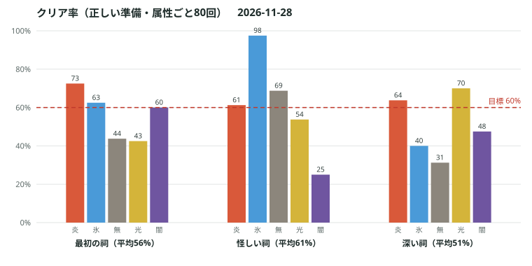

# バランスの記録

自動プレイ（正しい準備の装備＋回復薬・食料）で測った、ダンジョンごとのクリア率。目標は 60% 前後。測り方と再実行の方法は [README](./README.md)。

## いちばん新しい測定（2026-11-28・敵の強さを0.39倍・深い祠の倍率を下げた（#197）・属性ごとに80回）

| ダンジョン | 炎 | 氷 | 無 | 光 | 闇 | 平均 | 目標との差 |
| --- | ---: | ---: | ---: | ---: | ---: | ---: | :---: |
| 最初の祠 | 73% | 63% | 44% | 43% | 60% | **56%** | ◎ |
| 怪しい祠 | 61% | 98% | 69% | 54% | 25% | **61%** | ◎ |
| 深い祠 | 64% | 40% | 31% | 70% | 48% | **51%** | ◎ |

◎：目標±10ポイント以内　○：±20ポイント以内　△：それより外れている

## これまでの移り変わり（5つの属性の平均）

| 日 | 変えたこと | 回数 | 最初の祠 | 怪しい祠 | 深い祠 |
| --- | --- | ---: | ---: | ---: | ---: |
| 2026-11-28 | 調整前（敵の強さは10倍にしたまま） | 40 | 0% | 0% | 0% |
| 2026-11-28 | 敵の強さを0.39倍・深い祠の倍率を下げた（#197） | 80 | 56% | 61% | 51% |
